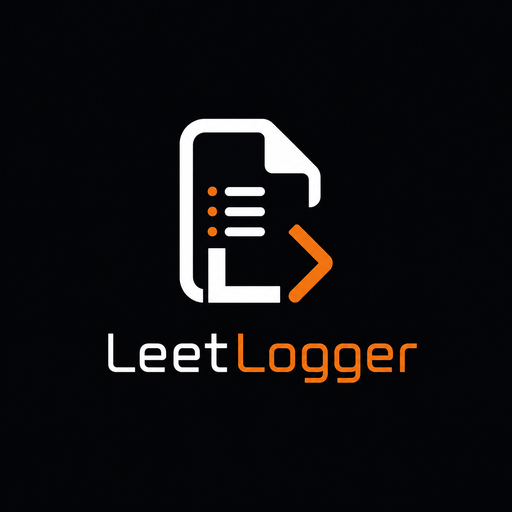
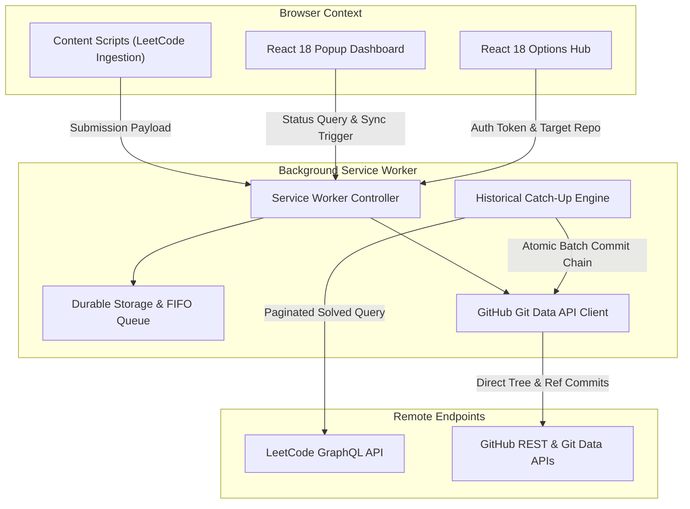

<p align="center">
  
</p>

<h1 align="center">LeetLogger 🚀</h1>

<p align="center">
  <strong>Automated, Zero-Friction LeetCode Submission Logging & Backdated Historical Catch-Up for GitHub</strong>
</p>

<p align="center">
  <a href="https://github.com/Inkesk-Dozing/LeetLogger/actions/workflows/ci.yml"></a>
  <a href="LICENSE"></a>
  <a href="src/manifest.json"></a>
  <a href="https://react.dev"></a>
  <a href="https://www.typescriptlang.org/"></a>
  <a href="https://github.com/Inkesk-Dozing/LeetLogger/stargazers"></a>
  <a href="CONTRIBUTING.md"></a>
</p>

---

## 🌟 Key Features

- **⚡ Instant Real-Time Sync**: Automatically intercepts accepted submissions on LeetCode, formats structured markdown problem statements with badges, and commits code files directly to your target GitHub repository.
- **📜 Historical Catch-Up Engine (Backdated Bulk Sync)**: Scans your target GitHub repository tree against your complete LeetCode solved archive and commits missing solutions with their **exact historical solve timestamps** (`author.date` / `committer.date`), populating your authentic GitHub contribution graph.
- **🔄 Durable Offline Queue**: Network blips or rate limits never lose code. Failed transactions persist in `chrome.storage.local` with automatic exponential backoff retry.
- **🎨 Glassmorphic React 18 Dashboard**: Sleek popup status tracker and options configuration dashboard styled with modern Vanilla CSS.
- **🛡️ Direct Peer-to-Peer Security**: Zero intermediate servers, telemetry proxies, or data aggregators. Direct, authenticated communication between the browser and GitHub APIs.

---

## 🏗️ Architecture Overview



For in-depth subsystem blueprints and sequence diagrams, explore the [System Architecture Overview](docs/architecture/overview.md).

---

## 🚀 Quick Start & Installation

### 1. Build from Source

```bash
# Clone the repository
git clone https://github.com/Inkesk-Dozing/LeetLogger.git
cd LeetLogger

# Install dependencies
npm install

# Build the production extension package
npm run build
```

### 2. Load into Google Chrome

1. Open Chrome and navigate to `chrome://extensions/`.
2. Toggle on **Developer mode** in the top-right corner.
3. Click **Load unpacked** and select the generated `dist/` directory inside `LeetLogger`.
4. Click the **LeetLogger** icon in your browser toolbar to link your GitHub repository and begin tracking!

---

## 📁 Repository Structure

```
LeetLogger/
├── .github/                   # CI/CD pipelines & CodeQL security scans
│   └── workflows/             # ci.yml and codeql.yml
├── assets/                    # Master visual branding, logos, and extension icons
├── docs/                      # Technical Documentation
│   ├── architecture/          # Subsystem blueprints & sequence diagrams
│   ├── api/                   # GitHub REST & Git Data API integration spec
│   ├── components/            # Component contracts & Big-O complexity specs
│   └── security/              # Threat model matrix & CSP definitions
├── src/
│   ├── manifest.json          # Chrome Manifest V3 configuration
│   ├── core/                  # Pure TypeScript engines (Git, Storage, Formatters)
│   ├── platform/              # LeetCode DOM observers & GraphQL fetchers
│   ├── background/            # Background service worker & sync orchestrators
│   ├── content/               # Web page DOM and OAuth interceptors
│   └── ui/                    # React 18 Popup and Options onboarding dashboards
├── webpack.config.js          # Webpack 5 production build config
├── tsconfig.json              # TypeScript configuration
└── LICENSE                    # Apache 2.0 License
```

---

## 📄 License

Licensed under the [Apache License, Version 2.0](LICENSE).