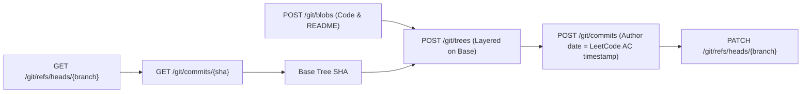

# GitHub REST & Git Data API Integration Specification

## Purpose

The `GitHubClient` subsystem manages low-level Git Data API operations and repository interactions. It enables LeetLogger to perform atomic multi-file tree commits, create backdated historical commits with authentic author timestamps, and fetch existing repository trees without cloning repository data locally.

---

## Authentication & Authorization

| Method | Header | Required Scopes | Security Storage |
| :--- | :--- | :--- | :--- |
| **Personal Access Token (PAT)** | `Authorization: Bearer <TOKEN>` | `repo` (private repos) or `public_repo` | `chrome.storage.local` (encrypted) |
| **GitHub OAuth Token** | `Authorization: token <OAUTH_TOKEN>` | `repo` | `chrome.storage.local` (encrypted) |

---

## Low-Level Git Data API Sequence

To preserve accurate submission timestamps (`author.date` and `committer.date`) and commit multiple files atomically without working tree overhead, LeetLogger leverages the Git Data API primitives:



### Detailed Endpoint Contract

1. **Verify or Initialize Repository**:
   - `GET /repos/{owner}/{repo}`: Checks existence and permissions.
   - `POST /user/repos`: Creates repository if missing with `auto_init: true`.
2. **Scan Existing Tree**:
   - `GET /repos/{owner}/{repo}/git/trees/{branch}?recursive=1`: Resolves full set of existing files in $O(1)$ network roundtrips.
3. **Blob Creation**:
   - `POST /repos/{owner}/{repo}/git/blobs`: Writes base64 encoded source files and Markdown READMEs. Returns `blob_sha`.
4. **Composite Tree Creation**:
   - `POST /repos/{owner}/{repo}/git/trees`:
     ```json
     {
       "base_tree": "base_tree_sha",
       "tree": [
         { "path": "leetcode/0001-two-sum/Solution.cpp", "mode": "100644", "type": "blob", "sha": "blob_sha_1" },
         { "path": "leetcode/0001-two-sum/README.md", "mode": "100644", "type": "blob", "sha": "blob_sha_2" }
       ]
     }
     ```
5. **Backdated Commit Object Creation**:
   - `POST /repos/{owner}/{repo}/git/commits`:
     ```json
     {
       "message": "Time: 45 ms (88.5%), Space: 14.2 MB (72.1%) - LeetLogger",
       "tree": "tree_sha",
       "parents": ["parent_commit_sha"],
       "author": {
         "name": "Username",
         "email": "username@users.noreply.github.com",
         "date": "2023-05-15T14:32:00.000Z"
       },
       "committer": {
         "name": "Username",
         "email": "username@users.noreply.github.com",
         "date": "2023-05-15T14:32:00.000Z"
       }
     }
     ```
6. **Branch Reference Update**:
   - `PATCH /repos/{owner}/{repo}/git/refs/heads/{branch}`: Fast-forwards the branch head reference to the newly minted commit SHA.

---

## Batch Commit Chaining Engine

To prevent GitHub secondary rate limits when synchronizing 100+ historical problems:
- `commitBatchChain` creates a sequence of chained commit objects (`Tree A -> Commit A -> Tree B -> Commit B`) in memory.
- Branch reference update (`git/refs/heads/{branch}`) is deferred to the end of the batch with checkpoint updates every 10 commits, cutting HTTP API transactions by ~70%.
