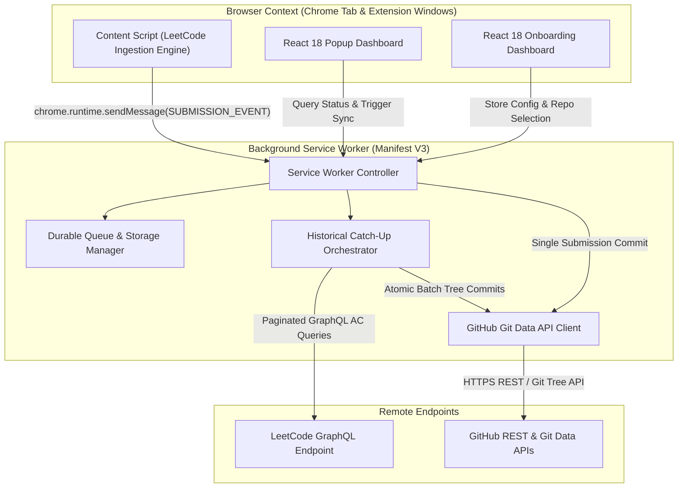
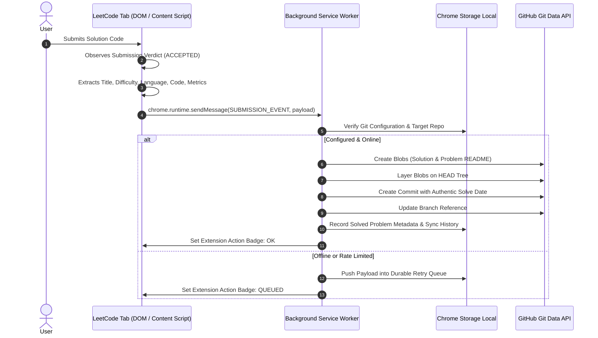
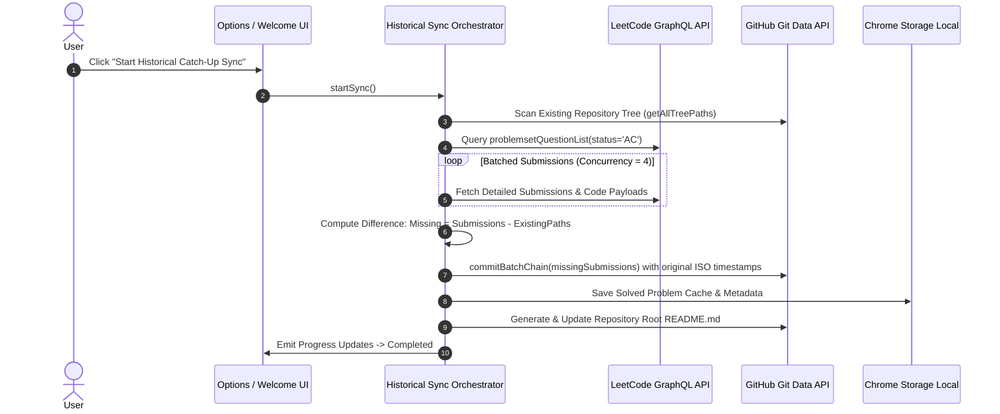

# LeetLogger System Architecture Overview

LeetLogger is an enterprise-grade Chrome Manifest V3 extension engineered to capture, format, and commit LeetCode problem solutions directly to GitHub with zero intermediate servers.

---

## 🏛️ System Decomposition

The system is decomposed into four decoupled, event-driven subsystems:

---

## 🔄 Sequence Workflows

### 1. Real-Time Submission Sync Workflow

### 2. Historical Catch-Up Sync Workflow

---

## 📂 Subsystem Directory Architecture

- **`src/content/`**: Content scripts targeting `https://leetcode.com/*` capturing DOM verdict panels and intercepting GraphQL API responses.
- **`src/platform/leetcode/`**: Dedicated LeetCode DOM parsing, submission data modeling, and paginated GraphQL historical fetcher.
- **`src/core/`**:
  - `git/`: Low-level Git Data API client handling trees, blobs, commits, and atomic chained commit batches.
  - `storage/`: Chrome local storage abstraction and durable FIFO retry queue.
  - `formatters/`: Markdown documentation generator, difficulty badges, and root repository catalog generator.
  - `types/`: Shared TypeScript data contracts and payload interfaces.
- **`src/background/`**: Manifest V3 background service worker, message router, alarms, and historical sync engine.
- **`src/ui/`**: Glassmorphic React 18 user interfaces for quick popup status tracking and repository settings management.
